<!--
  Layout notes
  - All three visuals are self-contained SVGs (no JavaScript, no external CSS). Their animation
    is one-shot and every file ends on its finished state; viewers who prefer reduced motion get
    the *-static.svg twins via <picture>.
  - Percent widths keep the portrait + card row exactly as wide as the heatmap at any container
    width. The two <picture> tags are deliberately adjacent with no whitespace between them;
    a stray space would wrap the card onto its own line.
  - No table is used for the side-by-side row: GitHub draws table borders and cannot shrink
    table cells that contain images, which makes layout tables fragile on narrow screens.
-->

  

<picture><source media="(prefers-reduced-motion: reduce)" srcset="assets/karthik-ascii-static.svg"></picture><picture><source media="(prefers-reduced-motion: reduce)" srcset="assets/info-card-static.svg"></picture>

## About me

I'm an AI/ML engineer who builds and deploys machine learning, deep learning and generative AI systems, from RAG pipelines and multi-LLM applications to computer vision and predictive models. I'm comfortable across the whole pipeline (data preparation, evaluation, deployment) using Python, TensorFlow and LangChain.

I'm pursuing an M.Tech in CSE (AI & ML). From April to June 2026 I was a Big Data Analytics Research Fellow (SRIP-2026) at the Goa Institute of Management, where I worked on blockchain-based agent-to-agent authentication for multi-agent AI systems.

## Technical skills

| Area | Tools |
| --- | --- |
| Programming & data | Python, Pandas, NumPy, Matplotlib, Seaborn, Power BI |
| Machine learning | Scikit-learn, XGBoost, Random Forest, Gradient Boosting, SMOTE, hyperparameter tuning |
| Deep learning & vision | TensorFlow, Keras, CNN, LSTM, ResNet50, VGG16, transfer learning, OpenCV, image classification |
| Generative AI & NLP | LangChain, LangGraph, AI agents, RAG pipelines, prompt engineering, Hugging Face Transformers, OpenAI APIs, NER, sentiment analysis, vector databases |
| Data, deployment & cloud | MySQL, PostgreSQL, MongoDB, Redis, Flask, Docker, Gunicorn, Streamlit, AWS, GCP, Git |

## Selected projects

| Project | What it does | Stack |
| --- | --- | --- |
| [**ShopMind AI**](https://github.com/karthik-vana/E-Commerce) Multi-LLM e-commerce chatbot | Production AI shopping assistant with sub-2 s responses; integrates 9 LLMs, 6 personas and 14 languages; deployed on Streamlit Cloud. | Python, Groq API, Streamlit, LLaMA 3.3 70B |
| [**FoodVision AI**](https://github.com/karthik-vana/FoodVision-AI) Food classification & nutrition engine | Three CNN architectures on 34 food categories with automated nutrient inference; served with Gunicorn and deployed to Hugging Face Spaces. | TensorFlow, ResNet50, VGG16, Flask, Redis, Docker |
| [**Telecom Customer Retention System**](https://github.com/karthik-vana/Telecom-Retention-System) | 7-step ML pipeline on 7,043 records with a real-time Flask REST API on Render. Reported: 98.5% accuracy, ROC-AUC 0.92, F1 0.89. | XGBoost, SMOTE, Scikit-learn, Flask |
| [**Credit Card Risk Prediction System**](https://github.com/karthik-vana/CREDIT-CARD_PREDICTION-) | Five ML models on 150,000+ financial records behind a real-time risk-scoring API. Reported: 85%+ accuracy, ROC-AUC 0.88, recall 82.4%. | XGBoost, Random Forest, SMOTE, Flask, Render |

Metrics are the figures reported in my CV; they are not independently re-verified here.

## Research & experience

- **Big Data Analytics Research Fellow, SRIP-2026**, Goa Institute of Management, Panaji (Apr–Jun 2026). Worked with senior faculty on blockchain-based agent-to-agent authentication, designed an authentication protocol for multi-agent AI systems and authored the resulting research paper.
- **AI/ML Engineer**, The Skill Union, Hyderabad (Aug 2025–Apr 2026, full-time). Built RAG pipeline components with LangChain and OpenAI GPT-4 APIs, integrated TensorFlow computer-vision models, ran model evaluation, and deployed and configured vector databases.
- **Data Science with GenAI Intern**, Innomatics Research Labs, remote (Nov 2025–Mar 2026). Delivered industry-style projects using MLOps, RAG, AI agents, LangChain, LangGraph, prompt engineering and AWS.
- **Publication:** [Power Quality Enhancement in Microgrid System Using PV-Based UPQC](https://ijsrem.com/download/power-quality-enhancement-in-microgrid-system-using-pv-based-upqc/), IJSREM, Apr 2025 (DOI 10.55041/IJSREM44631).
- **Education:** M.Tech CSE (AI & ML), Avanthi Institute of Engineering & Technology (JNTU-GV), 2025–2027 (pursuing). B.Tech EEE, Raghu Engineering College, 2021–2025, Government of Andhra Pradesh 4-year full merit scholarship awardee.

## Certifications & achievements

- **Certifications:** Oracle OCI Gen AI Professional (2025–27), Oracle OCI Data Science Professional, Google Advanced Data Analytics (Coursera), Google Gemini for Workspace (2025–28), AWS Machine Learning (Mar 2026).
- **UIDAI Data Hackathon 2026:** industry-level ML anomaly-detection system on national identity records; shortlisted among national entries.
- **Job simulations (Forage):** Tata Group GenAI Simulation; Deloitte Data Analytics Simulation.
- **Community:** Internshala Student Ambassador (2025), guided 25+ students; peer mentor in Python, ML fundamentals and career development.
- **Languages:** English (fluent), Telugu (native), Hindi (intermediate).

## Contact

- GitHub: [github.com/karthik-vana](https://github.com/karthik-vana)
- LinkedIn: [linkedin.com/in/karthik-vana](https://linkedin.com/in/karthik-vana)
- Email: [karthikvana236@gmail.com](mailto:karthikvana236@gmail.com)

---

The ASCII portrait is generated from my own photograph and the info card from my CV, both by the scripts in this repository (see [`docs/INSTALLATION.md`](docs/INSTALLATION.md)). The heatmap is drawn from GitHub's public contribution calendar (`github.com/users/karthik-vana/contributions`) and refreshed daily by a GitHub Actions workflow; GitHub is the source of that data.
